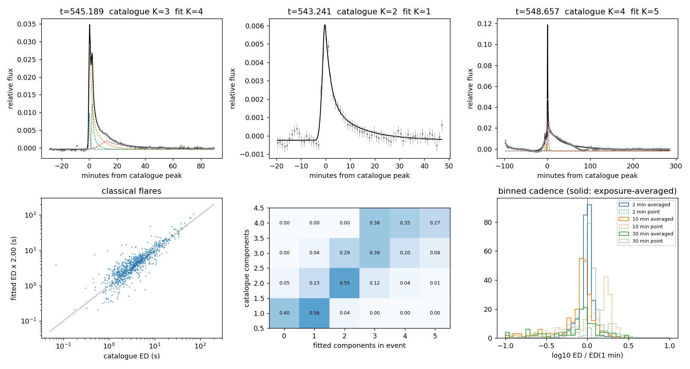

# Stellar Flares

## Overview

`fit_flares` decomposes a single-band light curve into a sum of
[Davenport et al. (2014)](https://arxiv.org/abs/1411.3723) flare templates plus
a polynomial baseline, choosing the number of components by BIC. It is built
for high-cadence surveys where many flare windows have to be fit quickly.

## Model

Each component is

$$
F(t) = A \, T\!\left(\frac{t - t_{\rm peak}}{t_{1/2}}\right)
$$

where $T$ is the median flare shape measured from 885 classical flares on
GJ 1243:

$$
T(x) =
\begin{cases}
0 & x < -1 \\
1 + 1.941x - 0.175x^2 - 2.246x^3 - 1.125x^4 & -1 \le x \le 0 \\
0.6890\,e^{-1.600x} + 0.3030\,e^{-0.2783x} & x > 0
\end{cases}
$$

All template coefficients are fixed, so each component has three free
parameters: peak time, FWHM ($t_{1/2}$) and peak amplitude $A$. The two decay
timescales are $0.625\,t_{1/2}$ and $3.59\,t_{1/2}$. The template area is
$\int T\,dx = 1.827$, so the equivalent duration is
$\mathrm{ED} = 1.827\,A\,t_{1/2}$.

Complex events are modelled as sums of templates. On GJ 1243 the extra
components typically capture an impulsive spike riding on a broader gradual
phase.

## Exposure averaging

Set `exposure_time` to the exposure length and each point is modelled as the
template averaged over its exposure, using the closed-form antiderivative
(exact, no sub-sampling). This matters whenever the FWHM is comparable to or
shorter than the exposure. A point-sampled template fit to binned data gets the
equivalent duration wrong by large factors (see validation below).

## Fitting

Amplitudes and baseline coefficients enter linearly, so for any trial set of
peak times and FWHMs they are solved by weighted least squares (variable
projection), with amplitudes constrained non-negative. That leaves a
2K-dimensional nonlinear search for K components:

1. Fit a baseline-only model (K = 0).
2. Seed a new component at the largest positive residual with an 11 × 20 grid
   over peak time and log FWHM, holding earlier components fixed.
3. Refine all peak times and FWHMs jointly with Nelder-Mead (two passes).
4. Accept the new component if BIC drops by more than `min_delta_bic`;
   otherwise stop.

A component is held at zero amplitude unless at least half of its area falls on
observed points. Without this, a narrow spike placed in a data gap can fit a
single noisy point with an arbitrarily inflated ED.

Uncertainties come from the Gauss-Newton covariance $(J^\top W J)^{-1}$ over all
parameters, scaled by the reduced χ² when it exceeds 1.

## Options

| Option | Default | Meaning |
|--------|---------|---------|
| `max_flares` | 4 | Largest number of components tried |
| `exposure_time` | `None` | Exposure length (same unit as times); `None` samples the template at each timestamp |
| `baseline_order` | 0 | 0 = constant, 1 = linear |
| `min_delta_bic` | 10 | BIC gain required for each extra component, including the first |
| `t_half_min` | 5% of median cadence | Lower FWHM bound |
| `t_half_max` | 25% of window | Upper FWHM bound; keeps slow trends from being absorbed as flares |

Flux should be normalised to the quiescent level (`F/F_q` or `F/F_q - 1`) so
that `equivalent_duration` is the usual ED, in the input time unit.

## Usage

```python
import lightcurve_fitting as lcf

res = lcf.fit_flares(t, rel_flux, rel_err, exposure_time=30 / 86400)
for f in res["flares"]:
    print(f["t_peak"], f["t_half"], f["amplitude"],
          f["equivalent_duration"] * 86400, f["equivalent_duration_err"] * 86400)

# Many windows in parallel
results = lcf.fit_flares_batch([(t1, f1, e1), (t2, f2, e2)], exposure_time=30 / 86400)

# Evaluate a model
y = lcf.flare_model(t, [t_peak], [t_half], [amp], exposure_time=30 / 86400)
```

```rust
use lightcurve_fitting::{fit_flares, FlareFitOptions};

let opts = FlareFitOptions { exposure_time: Some(30.0 / 86400.0), ..Default::default() };
let res = fit_flares(&times, &flux, &flux_err, &opts).unwrap();
```

## GPU batch fitting

With `--features metal` or `--features cuda`, `fit_flares_batch_gpu` runs the
component search on the GPU: one 32-lane SIMD group (Metal) or warp (CUDA) per
window executes the whole K = 0, 1, … loop (seed grid, Nelder-Mead, BIC), with
lanes splitting the per-point sums. The CPU then computes amplitudes,
baseline, uncertainties and fit statistics in double precision from the
selected peak times and widths, exactly as `fit_flares` does, so results have
the same meaning whichever backend found them.

```rust
use lightcurve_fitting::{fit_flares_batch_gpu, gpu::GpuContext, FlareFitOptions};

let gpu = GpuContext::new(0)?;
let results = fit_flares_batch_gpu(&gpu, &windows, &opts)?;
```

Metal kernels run in float32, so each window is rescaled before upload (times
in cadence units from the window start, flux median-subtracted and divided by
the median error) and the Nelder-Mead tolerance scales with χ². CUDA runs in
float64 with the CPU's tolerances. Both support up to 6 components and a
constant or linear baseline. Python bindings call the CPU path only.

`examples/flares_gpu_vs_cpu.rs` compares the two on every GJ 1243 window
(Apple M1 Max, Metal):

| Check | Metal vs CPU |
|-------|--------------|
| Same number of components | 99.6% (mismatches split evenly between more and fewer) |
| χ²(GPU) − χ²(CPU) | median 0.0002; GPU worse by > 2 in 0.8% of windows, better by > 0.5 in 0.8% |
| Matched components within 0.25σ (t_peak / FWHM / ED) | 96.7% / 97.4% / 97.3%; median offset 0.01σ |
| Total ED per window, GPU / CPU | 1.000 (5–95%: 0.995–1.005) |
| Wall time, 6107 windows | 1.7–1.8 s vs 3.6–3.9 s for the CPU on all 10 cores (rayon) |

The remaining differences are the two Nelder-Mead implementations settling in
different local optima on hard windows, in both directions.

The CUDA kernel has not been run on an NVIDIA GPU. CI compiles it, and
running its source serially on the host in double precision over the same
6107 windows reproduces the Metal search: same number of components in 99.6%
of windows, and for 98% of them a selected BIC between 0.84 below and 0.15
above Metal's (lower is better; double precision does slightly better).

## Validation on Kepler GJ 1243

`scripts/eval_flares_kepler.py` fits every event in the Davenport et al. (2014)
catalogue (6107 flares, 11 months of Kepler 1-min data, from
[GJ1243-Flares](https://github.com/jradavenport/GJ1243-Flares)) using windows
padded around the catalogue start and stop times.



**Throughput.** 6107 windows (median 38 points) take 6–7 ms each on one core,
or 3–7 s for all of them with `fit_flares_batch` on a 10-core M1 Max.

**Classical flares** (the 885 events used to build the template):

| Check | Result |
|-------|--------|
| Detected (≥1 component in event) | 96% |
| Peak time vs catalogue | 68% within 29 s (cadence 59 s) |
| ED vs catalogue | median ratio 1.08 (16–84%: 0.72–1.56) |
| ED vs trapezoid over catalogue start–stop | 1.12 (0.95–1.39); the excess is the template tail past the hand-picked stop time |
| Reduced χ² | median 0.97 |

The catalogue's fractional flux is 2.00× the light curve's
`detrended / median − 1`, measured from the peaks; EDs are compared after
removing that factor.

**Component counts.** Among classical flares, events the catalogue fit with one
template get one component 74% of the time; events it fit with two get two
58% of the time. Human-flagged complex events average 1.9 components versus
0.75 for classical ones. Many low-S/N catalogue flares (40% of single-component
events) do not pass the ΔBIC > 10 threshold.

**Coarser cadence.** For 271 classical flares with catalogue ED > 5 s (median
FWHM 2 min), the 1-min data were binned and refit:

| Bin | Model | Detected | ED / ED(1 min), median (16–84%) |
|-----|-------|----------|---------------------------------|
| 2 min | exposure-averaged | 100% | 1.00 (0.85–1.11) |
| 2 min | point-sampled | 100% | 1.04 (0.85–1.24) |
| 10 min | exposure-averaged | 95% | 0.88 (0.54–1.07) |
| 10 min | point-sampled | 95% | 1.24 (0.42–1.82) |
| 30 min | exposure-averaged | 47% | 0.87 (0.26–1.22) |
| 30 min | point-sampled | 46% | 0.23 (0.06–1.81) |

Once flares are unresolved the FWHM is not recoverable, but the ED still is
with exposure averaging, while point-sampled fits are biased and much noisier.

## Limitations

- The template is a single median shape. Bright flares often need a second
  component where the shape differs from the median rather than because there
  are two physical events; treat component counts as a description of the
  morphology.
- For flares much shorter than the exposure, amplitude and FWHM are degenerate;
  only the equivalent duration is constrained.
- Fits are single-band. Multi-band data can be fit band by band.
